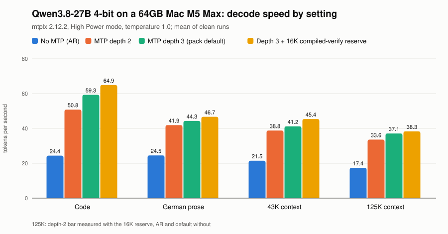
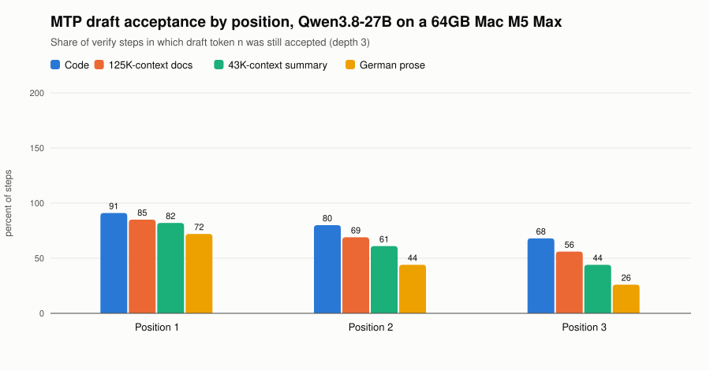
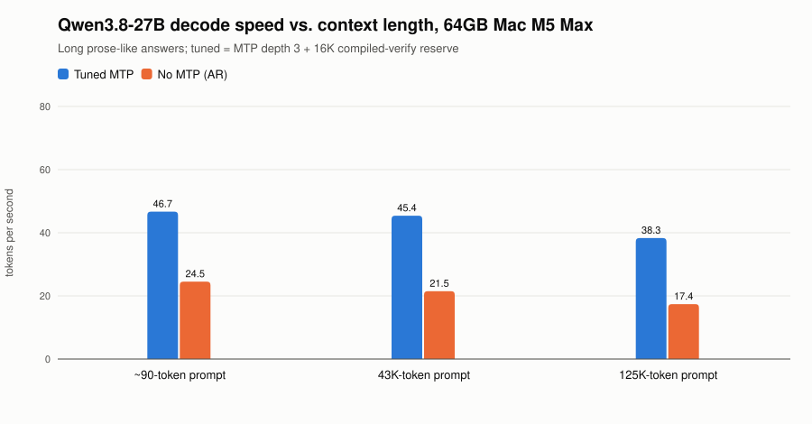
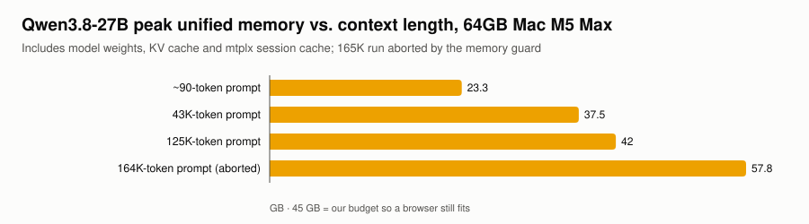
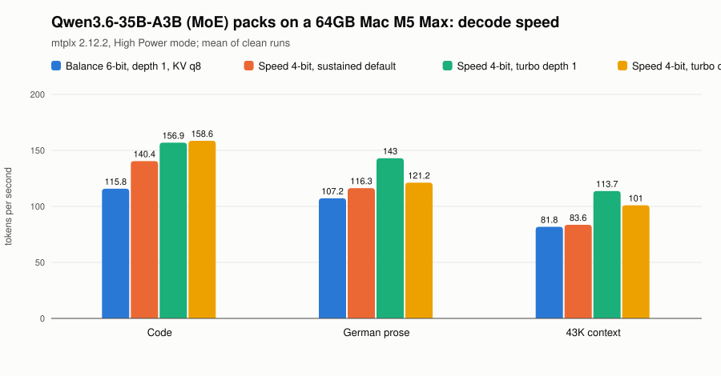
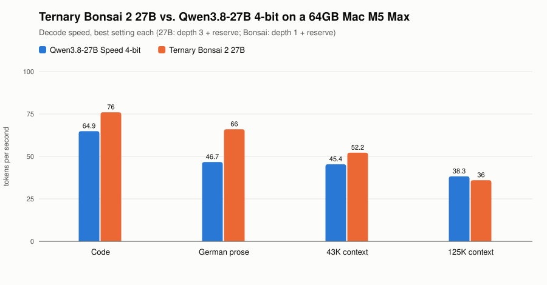
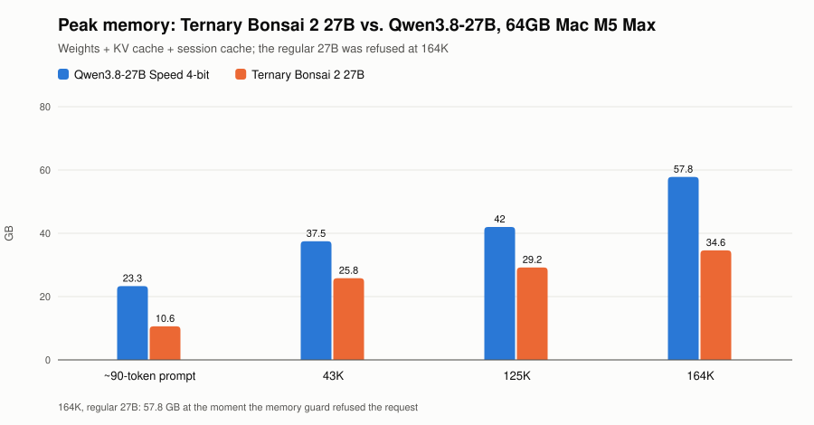
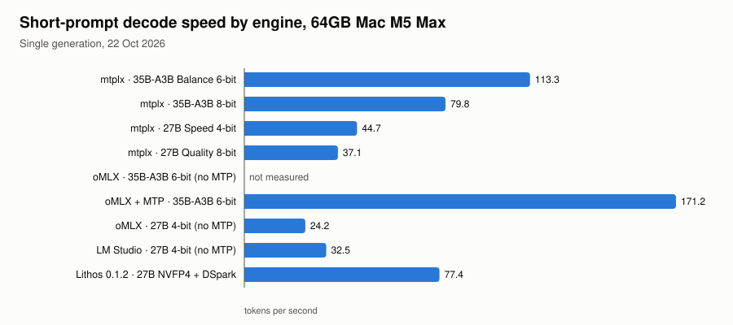
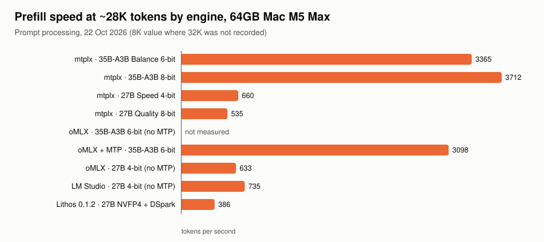
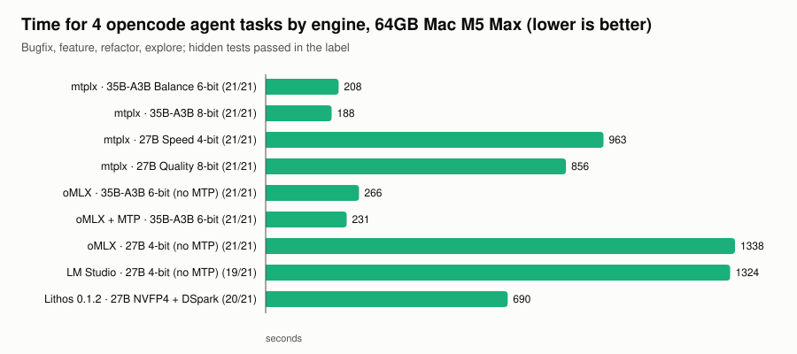

# Local LLMs on a 64GB Mac M5 Max: mtplx benchmarks for Qwen3.8-27B, Ternary Bonsai 2 27B and Qwen3.6-35B-A3B

Measured decode and prefill speed, MTP (multi-token prediction) acceptance, long-context
behaviour up to 164K tokens, memory, and the settings that made the difference, on one
**MacBook Pro M5 Max (40-core GPU, 64 GB unified memory)** running
[mtplx](https://pypi.org/project/mtplx/) 2.12.2. Raw data, the benchmark harness and the
chart script are in this repo.

> **Kurzfassung auf Deutsch.** Auf einem MacBook Pro M5 Max mit 64 GB haben wir Qwen3.8-27B
> und Qwen3.6-35B-A3B unter mtplx vermessen. Die wichtigsten Hebel: Beim 27B bringt eine
> größere Reserve für den kompilierten Verify-Pfad (`MTPLX_COMPILED_VERIFY_GROWTH_RESERVE=16384`)
> rund +10 %, MTP-Tiefe 3 ist am schnellsten, und die Token-Vorhersage verdoppelt das Tempo
> auch bei 125K Kontext. Beim 35B-MoE ist das **4-bit-Speed-Pack mit `--profile turbo` und
> Tiefe 1 rund 35 % schneller** als das 6-bit-Pack und braucht 9 GB weniger Speicher.
> 125K Kontext funktionieren beim 27B (Nadel 10/10, 38 tok/s, 42 GB), 164K sprengen mit
> 262K-Fenster die 64 GB. Und: Hochleistungsmodus an, 140-W-Netzteil am **MagSafe**
> (USB-C liefert höchstens 100 W), sonst sind die Zahlen nicht vergleichbar.
> **Ternary Bonsai 2 27B** (dasselbe Qwen3.8-27B, ternär, 8 GB) ist bei kurzem und mittlerem Kontext
> 15 bis 41 % schneller, braucht etwa die Hälfte des Speichers und schafft 164K, wo das normale 27B
> an den 64 GB scheitert; alle versteckten Tests bestanden, die Qualität ist aber nur grob geprüft.

## Key findings

| # | Finding | Effect |
|---|---|---|
| 1 | **27B: raise the compiled-verify growth reserve** (`MTPLX_COMPILED_VERIFY_GROWTH_RESERVE=16384`, `MTPLX_COMPILED_VERIFY_MAX_CONTEXT=262144`). The default 512 tokens make every longer answer fall back to the slow eager path. | Code 59 → **65 tok/s**, prose 44 → 47, 43K 41 → 45, 125K 37 → 38-40 |
| 2 | **MTP is the biggest lever and survives long context.** | 27B: 1.9x (prose) to 2.7x (code) vs plain decoding, 2.2x at 125K (38.3 vs 17.4 tok/s) |
| 3 | **27B: depth 3** (pack default) beats depth 2 everywhere, although depth 2 accepts more. | Code 3.41 tokens per verify step |
| 4 | **35B-A3B: use the 4-bit Speed pack with `--profile turbo --depth 1`** (KV off, same reserve). 6-bit packs never get the turbo kernels. | Code 116 → **157**, prose 107 → **143**, 43K 82 → **114 tok/s**, -9 GB peak |
| 5 | **Never quantize the KV cache on the 27B.** q8 disables the dense decode layouts and compiled verify. | 21 → 15 tok/s at ~40K |
| 6 | **Long context fits, with care.** 125K works (42 GB peak, ~3.7 min cold prefill). A 164K request with a 262K window grew the KV by +15.7 GB in one step and was refused at 57.8 GB. | Size the window to what you need |
| 7 | **The machine matters as much as the flags.** High Power mode, 140 W on MagSafe, a quiet machine, one model loaded. | see [checklist](docs/checklist.md) |
| 8 | **mtplx was the best all-round engine for these Qwen models**, but not in every column: oMLX with MTP decoded the MoE faster in a short test, LM Studio prefilled the 27B faster (735 vs 660 tok/s) at half the decode speed, and lithos-metal finished the 27B agent tasks faster (690 vs 963 s, one hidden test failed). | see [engines](#engines) |
| 9 | **Ternary Bonsai 2 27B** (Prism ML's ternary Qwen3.8-27B, 8.2 GB pack) at depth 1: faster than the regular 4-bit 27B except at 125K, half the memory, and it serves 164K where the 4-bit pack is refused. | Code 76, prose 66, 43K 52, 125K 36 tok/s; 11-35 GB peak |

## Machine and software

| | |
|---|---|
| Machine | MacBook Pro 16", Apple M5 Max, 40-core GPU, 64 GB unified memory, macOS 27.0.1 |
| Power | High Power mode, 140 W USB-C charger on MagSafe 3 |
| Engine | mtplx 2.12.2 (MLX 0.32.2, mlx-lm 0.31.3), single stream |
| Models | [Qwen3.8-27B Optimized Speed (4-bit)](https://huggingface.co/Youssofal/Qwen3.8-27B-MTPLX-Optimized-Speed), [Qwen3.6-35B-A3B Optimized Balance (6-bit)](https://huggingface.co/Youssofal/Qwen3.6-35B-A3B-MTPLX-Optimized-Balance), [Qwen3.6-35B-A3B Optimized Speed (4-bit)](https://huggingface.co/Youssofal/Qwen3.6-35B-A3B-MTPLX-Optimized-Speed) |
| Sampling | Server default of the packs (27B: temperature 1.0, top-p 0.95, top-k 20; 35B-A3B: temperature 0.6); thinking on |
| Memory budget | 45 GB for the model, so a browser still fits next to it |

## Results

### Qwen3.8-27B: what each setting does

<picture>
  <source media="(prefers-color-scheme: dark)" srcset="docs/img/27b-settings-dark.svg">
  
</picture>

| Setting | Code | German prose | 43K context | 125K context |
|---|---|---|---|---|
| No MTP (plain autoregressive) | 24.4 | 24.5 | 21.5 | 17.4 |
| MTP depth 2 | 50.8 | 41.9 | 38.8 | 33.6 ¹ |
| MTP depth 3 (pack default) | 59.3 | 44.3 | 41.2 | 37.1 |
| **Depth 3 + 16K compiled-verify reserve** | **64.9** | **46.7** | **45.4** | **38.3** |
| Depth 3 + 8K reserve | 65.8 | 48.5 | 45.2 | - |
| Depth 3 + reserve + prefill chunk 4096 | - | - | - | 39.5 |

Tokens per second (decode), mean of clean runs. ¹ measured with the 16K reserve.
On a 14K-token "marathon" answer: default 50.4, 8K reserve 52.2 (63 % compiled), **16K reserve 52.9** (100 % compiled).
Full table with prefill, acceptance, first/last-256 speed and peak memory:
`python3 bench/analyze.py results/2026-10-24_27b-*.json`.

### MTP acceptance: why code is faster than prose

<picture>
  <source media="(prefers-color-scheme: dark)" srcset="docs/img/27b-acceptance-dark.svg">
  
</picture>

At depth 3 the draft head proposes three tokens; the model verifies them in one pass and
always adds one of its own, so a step yields 1 to 4 tokens.

| Workload | Tokens per step | Position 1 kept | Position 2 | Position 3 |
|---|---|---|---|---|
| Code | 3.41 | 92 % | 80 % | 69 % |
| 125K-context documentation | 3.23 | 85 % | 69 % | 56 % |
| 43K-context summary | 2.98 | 83 % | 64 % | 47 % |
| German prose | 2.42 | 73 % | 43 % | 25 % |

### Context window

<picture>
  <source media="(prefers-color-scheme: dark)" srcset="docs/img/27b-context-decode-dark.svg">
  
</picture>

<picture>
  <source media="(prefers-color-scheme: dark)" srcset="docs/img/27b-context-memory-dark.svg">
  
</picture>

| Qwen3.8-27B 4-bit | ~90 tokens | 43K tokens | 125K tokens | 164K tokens |
|---|---|---|---|---|
| Decode, tuned MTP (prose-like) | 46.7 | 45.4 | 38.3 | aborted after 4,229 tokens |
| Decode, no MTP | 24.5 | 21.5 | 17.4 | - |
| Prefill | - | ~740 tok/s | ~560 tok/s | completed |
| Time to first token (cold) | <1 s | ~60 s | **~3.7 min** | ~5 min (estimated) |
| Peak memory | 23 GB | 37.5 GB | 42 GB | **57.8 GB (refused)** |
| Needle at 60 % depth found | - | - | **10 / 10** | - |

What decides the context window on a 64 GB Mac:

- **KV cache per token:** 27B 64 KiB (16 full-attention layers; the other 48 are Gated DeltaNet
  with fixed-size state), 35B-A3B 20 KiB. At 125K that is ~8 GB vs ~2.6 GB.
- **The KV cache grows in steps toward the configured window.** With a 262K window, a 164K
  request needed one +15.7 GB step and was refused. Set the window close to what you need;
  we now run the 27B with **163,840** (160K).
- **Dense-decode ceiling:** above `RAM × 15 % / 64 KiB` = **157,286 tokens** (64 GB) mtplx
  repages decode and loses its fast verify lane (developers: 16-18 → 12 tok/s).
  `MTPLX_DENSE_DECODE_RAM_PERCENT=16` moves it to 167,772.
- **Session cache:** mtplx keeps finished prompts for reuse (RAM up to ~25 GB, then SSD).
  Cap it for long work: `MTPLX_SESSION_BANK_MAX_BYTES=8G`.
- **Prefill is the real wait.** Bigger prefill chunks (4096 vs 2048) changed nothing (562 vs 561 tok/s).
  For agent loops, rely on prefix reuse rather than raw prefill speed.

Details and source references: [docs/details.md](docs/details.md).

### Qwen3.6-35B-A3B (MoE) packs

<picture>
  <source media="(prefers-color-scheme: dark)" srcset="docs/img/moe-packs-dark.svg">
  
</picture>

| Pack and setting | Code | German prose | 43K context | Prefill 43K | Peak memory |
|---|---|---|---|---|---|
| Balance 6-bit, depth 1, KV q8 (sustained) | 115.8 | 107.2 | 81.8 | 2,718 | 31-36 GB |
| Speed 4-bit, sustained default (KV q8) | 140.4 | 116.3 | 83.6 | 3,479 | 22-27 GB |
| **Speed 4-bit, turbo, depth 1, KV off, 16K reserve** | **156.9** | **143.0** | **113.7** | **3,567** | **22-27 GB** |
| Speed 4-bit, turbo, depth 2, KV off, 16K reserve | 158.6 | 121.2 | 101.0 | 3,633 | 22-27 GB |

Earlier tuning of the 6-bit pack (22 Oct): depth 1 beat the pack default by ~30 % on short
prompts (91-95 vs 70-77 tok/s). Adaptive depth did not help consistently
(`results/2026-10-22_mtplx-start-options.json`).
Note the lower acceptance of the 4-bit pack under the sustained profile (code 0.64 vs 0.82).
Agent tasks with the winning setting (turbo, depth 1): **21/21 hidden tests in 105 s**, against
208 s for the 6-bit pack on 22 Oct (`results/2026-10-25_agent-tasks.json`).

### Ternary Bonsai 2 27B: same model, ternary weights

[Ternary Bonsai 2 27B](https://huggingface.co/Youssofal/Ternary-Bonsai-2-27B-MTPLX-Optimized-Speed)
is Prism ML's ternary version of Qwen3.8-27B (Prism ML reports 98.2 % of the original's benchmark
average on its own suite; not independently verified). The mtplx pack is 8.2 GB instead of ~20 GB.

<picture>
  <source media="(prefers-color-scheme: dark)" srcset="docs/img/bonsai-vs-27b-dark.svg">
  
</picture>

<picture>
  <source media="(prefers-color-scheme: dark)" srcset="docs/img/bonsai-memory-dark.svg">
  
</picture>

| Bonsai 2 27B (KV off, 16K reserve) | Code | German prose | 43K context |
|---|---|---|---|
| **Depth 1 (pack default)** | **76.0** | **66.0** | **52.2** |
| Depth 2 | 69.4 | 55.8 | 46.3 |
| Depth 3 | 71.2 | 49.9 | 44.2 |

| Long context, depth 1, window 196,608 | 126K-token prompt | 164K-token prompt |
|---|---|---|
| Decode | 36.0 tok/s (8,000 tokens) | 33.2 tok/s (only 286 tokens written) |
| Prefill / time to first token | 568 tok/s / 3.7 min | 511 tok/s / 5.4 min |
| Peak memory | 29.2 GB | 34.6 GB |
| Needle at 60 % depth | found | found |

Agent tasks: **21/21 hidden tests in 857 s** (the regular 27B: 21/21 in 963 s on 22 Oct, before
the compiled-verify fix). The feature task took 446 s and 60 tool calls, more detours than the
regular 27B needed. At 164K the two models did not run with identical settings (the 4-bit pack
had a 262K window, Bonsai 196K), so the memory comparison there shows what fits, not a strict A/B.

### Engines

Measured on 22 Oct 2026 with the same machine. The 27B times predate finding 1.

<picture>
  <source media="(prefers-color-scheme: dark)" srcset="docs/img/engines-decode-dark.svg">
  
</picture>

<picture>
  <source media="(prefers-color-scheme: dark)" srcset="docs/img/engines-prefill-dark.svg">
  
</picture>

<picture>
  <source media="(prefers-color-scheme: dark)" srcset="docs/img/engines-agent-dark.svg">
  
</picture>

| Engine · model | Decode (short) | Prefill ~28K | Tool calls | Agent tasks (hidden tests) | Agent time |
|---|---|---|---|---|---|
| mtplx · 35B-A3B Balance 6-bit | 113.3 | 3,365 | 8/8 | 21/21 | 208 s |
| mtplx · 35B-A3B 8-bit | 79.8 | 3,712 ² | 8/8 | 21/21 | 188 s |
| mtplx · 27B Speed 4-bit | 44.7 | 660 | 8/8 | 21/21 | 963 s |
| mtplx · 27B Quality 8-bit | 37.1 | 535 | 8/8 | 21/21 | 856 s |
| oMLX + MTP · 35B-A3B 6-bit | 171.2 | 3,098 | 8/8 | 21/21 | 231 s |
| oMLX · 35B-A3B 6-bit (no MTP) | - | - | - | 21/21 | 266 s |
| oMLX · 27B 4-bit (no MTP) | 24.2 | 633 | 7/8 | 21/21 | 1,338 s |
| LM Studio · 27B 4-bit (ignores MTP) | 32.5 | 735 | 7/8 | 19/21 | 1,324 s |
| lithos-metal 0.1.2 · 27B NVFP4 + DSpark | 77.4 | 386 | 8/8 | 20/21 | 690 s |

² 8K value. Agent tasks: `opencode run --auto` on four small repositories (bugfix, feature,
refactor, explore), scored by hidden tests, one run each. These tasks are easy enough that most
setups reach 21/21; they measure end-to-end agent speed more than model quality.

## Recommended settings (64 GB M5 Max)

```bash
# Qwen3.8-27B Optimized Speed (4-bit): quality model, long context up to ~160K
# (turbo profile and depth 3 are the pack defaults)
MTPLX_COMPILED_VERIFY_GROWTH_RESERVE=16384 MTPLX_COMPILED_VERIFY_MAX_CONTEXT=262144 \
MTPLX_DENSE_DECODE_RAM_PERCENT=16 MTPLX_SESSION_BANK_MAX_BYTES=8G \
mtplx serve --model Youssofal/Qwen3.8-27B-MTPLX-Optimized-Speed \
  --paged-kv-quantization off --context-window 163840

# Qwen3.6-35B-A3B Optimized Speed (4-bit): fast bulk model
MTPLX_COMPILED_VERIFY_GROWTH_RESERVE=16384 MTPLX_COMPILED_VERIFY_MAX_CONTEXT=262144 \
mtplx serve --model Youssofal/Qwen3.6-35B-A3B-MTPLX-Optimized-Speed \
  --profile turbo --depth 1 --paged-kv-quantization off

# Ternary Bonsai 2 27B: same model family, half the memory, room for ~190K context
MTPLX_COMPILED_VERIFY_GROWTH_RESERVE=16384 MTPLX_COMPILED_VERIFY_MAX_CONTEXT=262144 \
MTPLX_DENSE_DECODE_RAM_PERCENT=20 MTPLX_SESSION_BANK_MAX_BYTES=8G \
mtplx serve --model Youssofal/Ternary-Bonsai-2-27B-MTPLX-Optimized-Speed \
  --depth 1 --paged-kv-quantization off --context-window 196608
```

The environment variables apply to the server they prefix. Keep only one model loaded at a time.

## Before you compare numbers

Read the [checklist](docs/checklist.md). The short version:
High Power mode, 140 W charger on **MagSafe** (USB-C stops at 100 W), battery guard for long
runs, a quiet machine (no test suites or large downloads in parallel), one model loaded,
same sampling, warm-up once, random prefix to defeat the cache, and read mtplx's own request log.

## Reproduce

```bash
pip install mtplx                       # 2.12.2 was used here
python3 bench/mtpbench.py bench/configs/example.json results/mine.json
python3 bench/analyze.py results/mine.json
python3 bench/charts.py                 # rebuilds docs/img from results/*.json
```

`bench/mtpbench.py` starts `mtplx serve` per config, warms up, runs the workloads
(code, German prose, 43K summary, 125K documentation with a hidden needle, 16K marathon),
waits for a quiet machine and enough free memory, pauses on low battery, and records mtplx's
per-request metrics. Long-context workloads read text from `CORPUS_DIR` (any large source tree).

## Data

| File | Content |
|---|---|
| `results/2026-10-22_engine-comparison.json` | engines: micro benchmark, tool calls, agent tasks |
| `results/2026-10-22_mtplx-start-options.json` | depth / KV / adaptive-depth runs (22-23 Oct) |
| `results/2026-10-24_27b-short-context.json` | 27B settings, short and 43K prompts, marathon |
| `results/2026-10-24_27b-125k-context.json` | 27B at 125K, needle check |
| `results/2026-10-24_27b-165k-attempt.json` | the refused 164K request and why |
| `results/2026-10-25_moe-35b-a3b.json` | 35B-A3B packs and settings |
| `results/2026-10-25_bonsai2-27b.json` | Ternary Bonsai 2 27B: depths, 126K, 164K |
| `results/2026-10-25_agent-tasks.json` | agent tasks for the 4-bit MoE and Bonsai |

Every row keeps the mtplx request-log fields (acceptance per depth, compiled-verify calls,
peak memory, thermal pressure, system load, battery level).

## Limitations

- One machine, one engine version, mostly two runs per cell. Differences below ~3 % are noise.
- No fan control: almost all 27B runs reported `heavy` thermal pressure; with fans pinned at
  maximum (as the pack authors measure) long outputs are likely faster.
- Agent tasks are small; they separate engines by time, not models by intelligence. The Bonsai
  quality claim (98.2 %) is Prism ML's own; our check is only these four tasks and a needle test.
- Prompts are partly German; English prose will accept MTP drafts differently.

## License

MIT for code, CC BY 4.0 for data and charts. Model names and numbers from model cards belong
to their authors.
